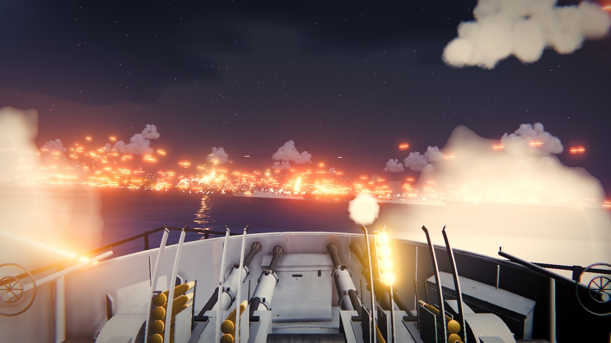

# Battle Stations: anti-aircraft guns in the Pacific, 1944



**Man the anti-aircraft guns of the battleship USS Alabama as Japanese aircraft attack her carrier task group in June 1944.**

**Why it's different:** the guns work like the real ones. The Bofors is fed clip by clip, the mounts swing at their real speed, every round flies with drag and gravity, and nearly everything you see and hear is generated in code.

## What you do

- **Run to your gun.** General quarters sounds, and you race with your shipmates from your bunk up through the ship to Mount 47.
- **Lead your targets.** Your rounds take seconds to arrive. On the easier settings a lead computing sight shows where to aim.
- **Take any gun.** Hold `Ctrl` for the ship's plan and man any of her 55 anti-aircraft mounts: 5", 40mm or 20mm.
- **Fight by day or by night.** Six day raids of dive bombers, torpedo planes, strafing Zeros and kamikazes, or six night torpedo attacks under parachute flares.
- **Keep the guns fed.** Loaders, passers and the hoist keep up, until you outrun them.

## Play it

```bash
npm install
npm run dev      # http://localhost:5199
```

You need a browser with WebGL2. `npm run build` makes a `dist/` folder that runs from any web server, such as itch.io or GitHub Pages ([details](docs/DEVELOPMENT.md)).

## Controls

| Key | Action |
|---|---|
| Mouse | train and elevate |
| Left button | fire |
| Right button | zoom the sight |
| hold `Ctrl` | the ship's plan: click a mount to man it |
| `X` | change your view on the gun |
| `R` | change drums (20mm) |
| `C` | watch from the cinematic camera |
| `Esc` | pause and open the settings |

[Every key](docs/PLAYING.md#controls)

## Status

Playable from start to finish: the General Quarters run, both battles, the after-action report and endless mode, on three difficulties.

Not done yet:

- An in-game credits screen, needed for the CC BY recording before the game is published.
- Gamepad support.
- The Mk 51 directors that aimed the 40mm quads.
- About 17 more 20mm guns: Alabama had about fifty in mid-1944, and the game has 33.
- Spent cases from the 5" guns.

## Go deeper

- [How to play](docs/PLAYING.md): the opening, the guns, the Bofors feed, the day and night raids, every key.
- [What's modelled](docs/MODELLED.md): the rendering, the simulation and the sound.
- [History and sources](docs/HISTORY.md): what is real, what is reconstructed, and what is a game value.
- [Development](docs/DEVELOPMENT.md): sharing the build, headless testing, the source layout.

## More games

- [Echelon](https://github.com/drichards188/echelon): command a layered air defense, from today's missile systems to the German flak of 1945.
- [Drumfire](https://github.com/drichards188/drumfire): command heavy artillery, from Ypres in 1917 to the Gustav.

## Credits

- [three.js](https://threejs.org) and [lil-gui](https://lil-gui.georgealways.com) (MIT); [Vite](https://vite.dev) (MIT) for development.
- Ten real recordings, listed in [public/audio/CREDITS.md](public/audio/CREDITS.md): eight CC0 from Freesound, the US Navy's general alarm (public domain), and "Tykki, laukaus / Big gun, cannon, 76 mm, single shots, gunshots" by YleArkisto ([source](https://freesound.org/s/332935/), [CC BY 4.0](https://creativecommons.org/licenses/by/4.0/)).
- The project has no license file.
